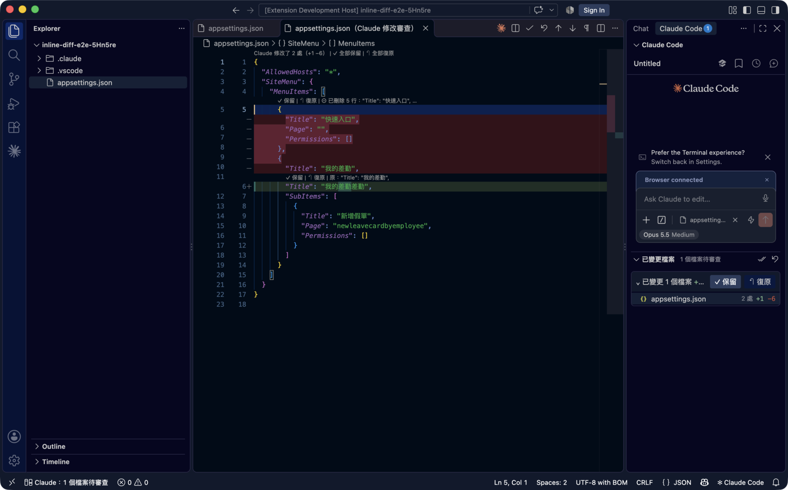

# Inline Diff Review for Claude Code

Review the edits Claude Code makes, GitHub Copilot style: open a changed file and see exactly what the AI changed — deleted lines in red, added lines in green — then keep or undo each change.

以類似 GitHub Copilot 的方式審查 Claude Code 的修改：打開檔案就看到 AI 改了哪些——AI 刪掉的是紅色列、新增的是綠色列，逐段保留或復原。不需要 API key，搭配官方 Claude Code（訂閱登入）使用。

> 這是社群開發的擴充套件，與 Anthropic 無關聯。Claude 與 Claude Code 是 Anthropic 的商標。

## 畫面

## 功能

- Claude 修改檔案後，聊天視窗下方的「已變更檔案」清單列出每個檔案的 `+新增 −刪除` 行數
- 有待審查修改的檔案，不管從清單或檔案總管打開，都以「AI 修改」畫面顯示：紅色列是 AI 刪掉的、綠色列是 AI 新增的，其餘內容照常顯示
- 畫面就是原始檔案本身，可以直接編輯、存檔；全部處理完自動回到一般分頁
- 標題列有全部保留、全部復原
- 每處修改上方都有 `✓ 保留` / `↶ 復原`
- 只審查 Claude 的修改：你自己手動改的內容不會被算進去，Claude 改過後又被你手動改到的段落不會被自動復原
- 也可以改成直接在原始檔案中以紅綠標示審查（設定 `claudeInlineDiff.reviewMode` = `inline`）

## 開始使用

1. 需要 VS Code 1.90 以上、已登入的 Claude Code，以及 Node.js（`node -v` 有版本即可）
2. 開啟專案資料夾，`Ctrl+Shift+P`（Mac：`Cmd+Shift+P`）→ **Inline Diff: 安裝 Claude Code hook 到此工作區**
3. 開一個新的 Claude Code 對話，讓它修改檔案

每個專案做一次第 2 步；hook 寫在該專案的 `.claude/settings.local.json`，不會被 commit。**更新擴充套件版本後要重新執行一次第 2 步。**

## 快捷鍵

| 操作 | Windows / Linux | Mac |
|---|---|---|
| 保留此檔案全部修改 | `Ctrl+Alt+Y` | `Cmd+Alt+Y` |
| 復原此檔案全部修改 | `Ctrl+Alt+N` | `Cmd+Alt+N` |
| 下一處 / 上一處修改 | `Alt+F5` / `Shift+Alt+F5` | 同左 |

## 設定

| 設定 | 預設 | 說明 |
|---|---|---|
| `claudeInlineDiff.reviewMode` | `diff` | `diff`：以「AI 修改」畫面審查（紅綠整列）；`inline`：在一般分頁中以精簡標示審查 |
| `claudeInlineDiff.autoOpen` | `false` | Claude 修改後自動開啟該檔案 |

本擴充套件會把 `diffEditor.codeLens` 預設為開啟、`diffEditor.renderSideBySide` 預設為關閉（上下排），讓保留 / 復原按鈕與紅綠整列出現在「AI 修改」畫面中。

完整說明與疑難排解見 [安裝說明.md](安裝說明.md)。
